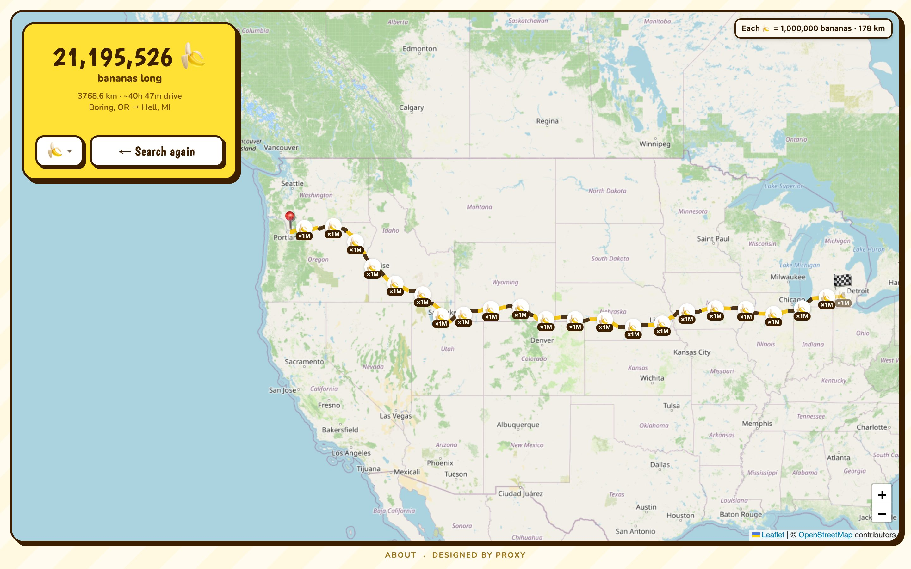
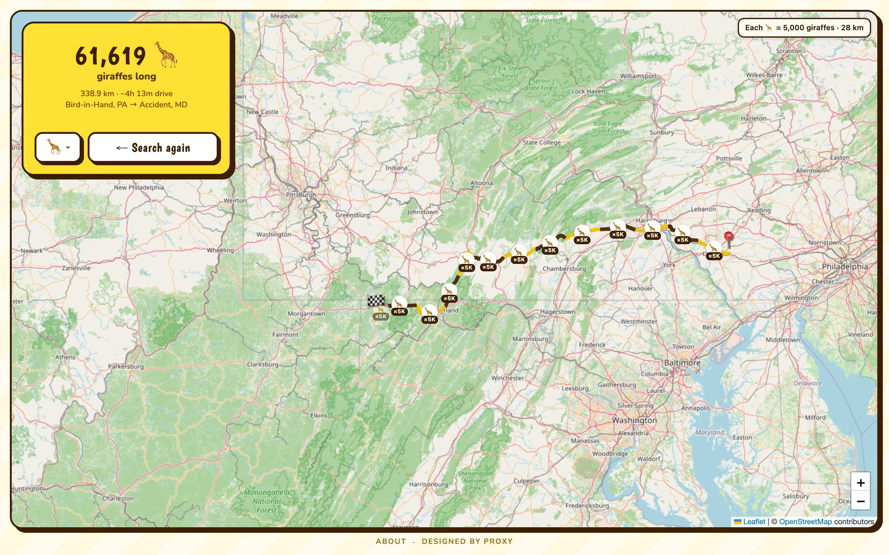
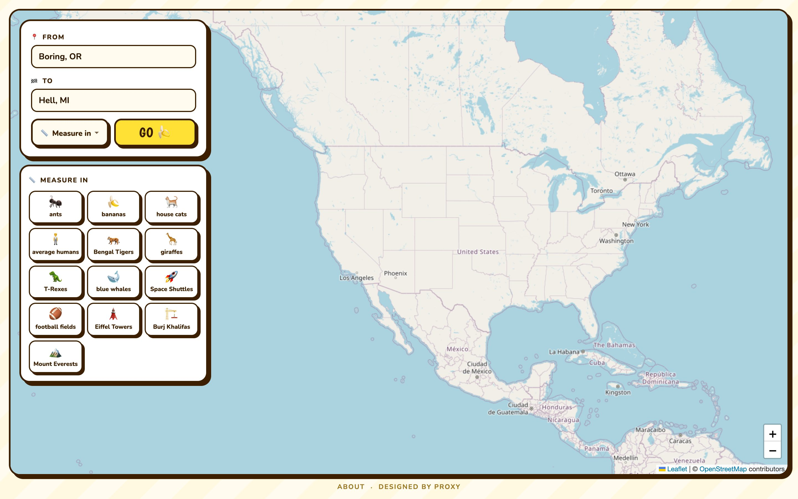
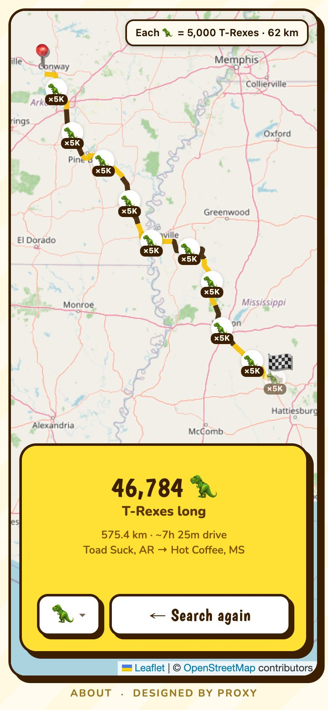
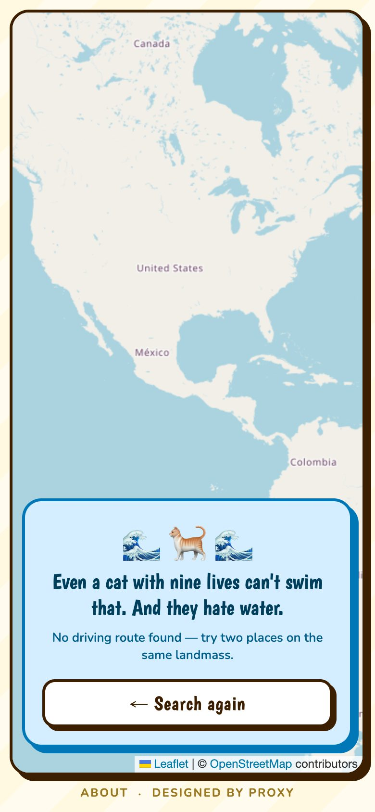

# 🍌 banana for scale

> Because meters are deeply, profoundly boring.

**[Try it → experiments.designbyproxy.com/bananaforscale](https://experiments.designbyproxy.com/bananaforscale/)**

Pick any two places, pick a unit of measurement that actually means something to a human being (a banana, a giraffe, a T-Rex), and find out how long your road trip *really* is.

Boring, Oregon to Hell, Michigan? That's **21,195,526 bananas**. You're welcome.



---

## Why does this exist?

The metric system was a triumph of the Enlightenment. It is also, unfortunately, no fun at all. Nobody has ever pictured "338.9 km" in their head. But **61,619 giraffes standing nose-to-tail across Pennsylvania**? You can *see* that. You can't *un-see* that.



## The official units of measurement

Rigorously sourced. Mostly.

| | Unit | Length |
|---|---|---|
| 🐜 | Ants | 1.2 in |
| 🍌 | Bananas | 7 in (the international standard) |
| 🐈 | House cats | 18 in, not counting attitude |
| 🧍 | Average humans | 5′7″ |
| 🐅 | Bengal tigers | 12 ft |
| 🦒 | Giraffes | 18 ft |
| 🦖 | T-Rexes | 40 ft |
| 🐋 | Blue whales | 98 ft |
| 🚀 | Space Shuttles | 184 ft |
| 🏈 | Football fields | 100 yd |
| 🗼 | Eiffel Towers | 1,083 ft |
| 🏗️ | Burj Khalifas | 2,717 ft |
| 🏔️ | Mount Everests | 29,032 ft |



## Features nobody asked for

- **The route is drawn to scale, literally.** Every stripe on the road is a real, measured stretch of N units, with the emoji parked in the middle. Zoom in and the stripes get shorter: a million bananas becomes 500,000, then 200,000, all the way down to 100 bananas at street level. Blue whales and up go all the way to life-size (one icon, one whale).
- **Perform-ant.** Intentionally designed so no browser has to render 9 million individual ants.
- **Default destinations of questionable origin.** Every visit pre-fills a random pair from 39 real towns in the lower 48, including Toad Suck AR, Monkeys Eyebrow KY, Why AZ, Hot Coffee MS, Two Egg FL, Zzyzx CA, Truth or Consequences NM and, of course, Boring OR and Hell MI. Any pair is drivable. Some are a commitment.
- **Ocean detection.** Try driving to Hawaii. Your chosen unit will have something to say about it.

<p align="center">
  
  &nbsp;&nbsp;
  
</p>

## How it works

| Job | Who does it |
|---|---|
| UI | [React](https://react.dev) + [Vite](https://vitejs.dev) |
| Map | [Leaflet](https://leafletjs.com) via [react-leaflet](https://react-leaflet.js.org), tiles from [OpenStreetMap](https://www.openstreetmap.org) |
| "Where is Toad Suck?" | [Photon](https://photon.komoot.io) geocoder |
| "How do I drive there?" | [OSRM](https://project-osrm.org) routing |
| Hosting | A static-assets [Cloudflare Worker](https://developers.cloudflare.com/workers/static-assets/) |

No API keys, no accounts, no backend. Just bananas.

The scale ladder steps 1, 2, 5, 10, 20, 50… so the units per icon only change when you finish zooming, and only the stripes currently on screen get drawn (on a single canvas). Even a 41,000-point coast-to-coast route pans smoothly.

## Run it yourself

```bash
npm install
npm run dev
# → http://localhost:5173/bananaforscale/
```

Deploy with `npm run deploy` (builds, then `wrangler deploy`). Pushes to `main` also deploy automatically through Cloudflare's GitHub integration. The route lives in `wrangler.jsonc`.

There's also `bananaforscale.html`, the original single-file prototype, kept around for sentimental reasons.

## Credits

Map data © [OpenStreetMap](https://www.openstreetmap.org/copyright) contributors. Geocoding by Photon (komoot), routing by OSRM. These are free community services, so please be gentle with them.

Bananas © nature.

---

Designed by [Proxy](https://designbyproxy.com).
